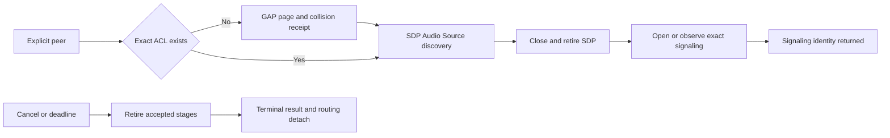

# Owner connection coordinator — 2026-11-05

The new dbt_a2dp_connect.c/h joins the previously separate caller-selected GAP paging, Audio Source SDP discovery and A2DP signaling entry points. Product wrappers now reserve SDP routing and drive the coordinator from the existing audio owner poll/deadline path. There is no default context, peer selection, remembered-peer persistence, task, heap allocation or automatic begin caller. Endpoint/configuration/stream initiation remains unfinished. Signaling-ready is not an audio-ready claim.

## Ownership and bounds

The caller initializes storage once, supplies disjoint SDP request/response buffers and explicitly selects a Classic address. A matching existing ACL is reused; paging otherwise uses the existing GAP capacity/collision/command-retirement rules. The coordinator consumes the GAP receipt before progressing. It does not confer bond trust or open a pairing window. Signaling still uses the normal asynchronous security provider and verified encryption policy.

SDP has one reserved routing lease. The coordinator owns its polling; legacy discovery cancel/result functions cannot steal that lease. Its exact client channel is routed separately from server channels, avoiding an unnecessary server-slot claim. Terminal product dial_result detaches routing before permitting caller context/buffer release. Detailed paging status fields, SDP/query/channel results and exact signaling event/reason/wire result/owner timestamp stay separate. An event-seen flag distinguishes absent metadata from a real zero status. Owner timestamps are not radio arrival times.

Cancellation only closes signaling created by this operation. A same-peer incoming signaling connection can be observed without claiming cancellation ownership. Shared ACLs are never silently disconnected; a page that wins cancellation is reported with its exact handle/generation for the broader connection policy. Successful signaling is handed to the existing profile; failures/cancellation await owned signaling/channel/worker retirement. The overall deadline chooses an outcome but never shortens a borrowed-storage release fence. Lower-layer retirement may outlast that deadline.

Product cancel/result APIs require both context identity and local token, preventing equal token values in different caller objects from affecting each other. Reusing a completed context preserves its serial; exhaustion fails closed. Overlap is rejected before mutating caller context/buffer/output storage. A lost accepted token is a software ownership fault: the host fails closed, the context remains retained and its wait query does not produce a retry spin. Such fault recovery remains incomplete; no caller may reset/free retained storage as if completion had occurred.

Each owner call performs one phase or a bounded retirement pass. Full fixed pools wait for resource/protocol events and finite deadlines. A contradictory begin refusal is reported rather than repeatedly allocating. Pure GAP readiness lets the coordinator consume a completed page receipt without losing its wakeup. Existing runtime/GAP/profile polling remains required; no task delays or controller-busy loops are added.

## Reference and integration scope

The pinned BTstack avdtp.c:331–389 connection entry was compared as the SDP-backed profile reference. The implementation independently composes the owned GAP/page, SDP and acceptor APIs, including their explicit lifetime fences. No reference implementation is integrated. Existing incoming A2DP/AVRCP/BLE paths and codec/PCM/affinity settings are preserved in source.

Owner poll/wait/event and SDP/signaling code are linked. The explicit product begin API still has no automatic caller and is removed by link garbage collection in this configuration; no peer is paged or probed at boot by this module. This stage therefore does not establish automatic reconnection. Durable peer policy, backoff/handover, local AVDTP endpoint selection/configuration/start, complete feature/security/lifecycle and audio qualification remain open.

## Evidence

Strict C11 Clang analysis passes for the coordinator and changed GAP code. Full ESP-IDF 6.1 ccache compilation and source stability pass. A compiler-only Xtensa object (never linked/executed) measures context 428 bytes and result 168 bytes; SDP buffers are additional caller-owned temporary storage. Persistent BSS changes 50300→50308 bytes. IRAM text remains 122255, DRAM data 23893 and aggregate data 396577. Whole text changes 867363→870867 bytes, entirely in flash. No task-stack allocation is added; activation stack/latency/heap behavior is not qualified.

Ordinary boot/readback is recorded separately. Cold codec startup checks do not exercise this coordinator. No unit, simulated-peer, paging/pairing, SDP/connection, packet-injection, playback, app, timing, backpressure or fault campaign was invoked under the user hold. No real-time headroom or underrun improvement is claimed.
