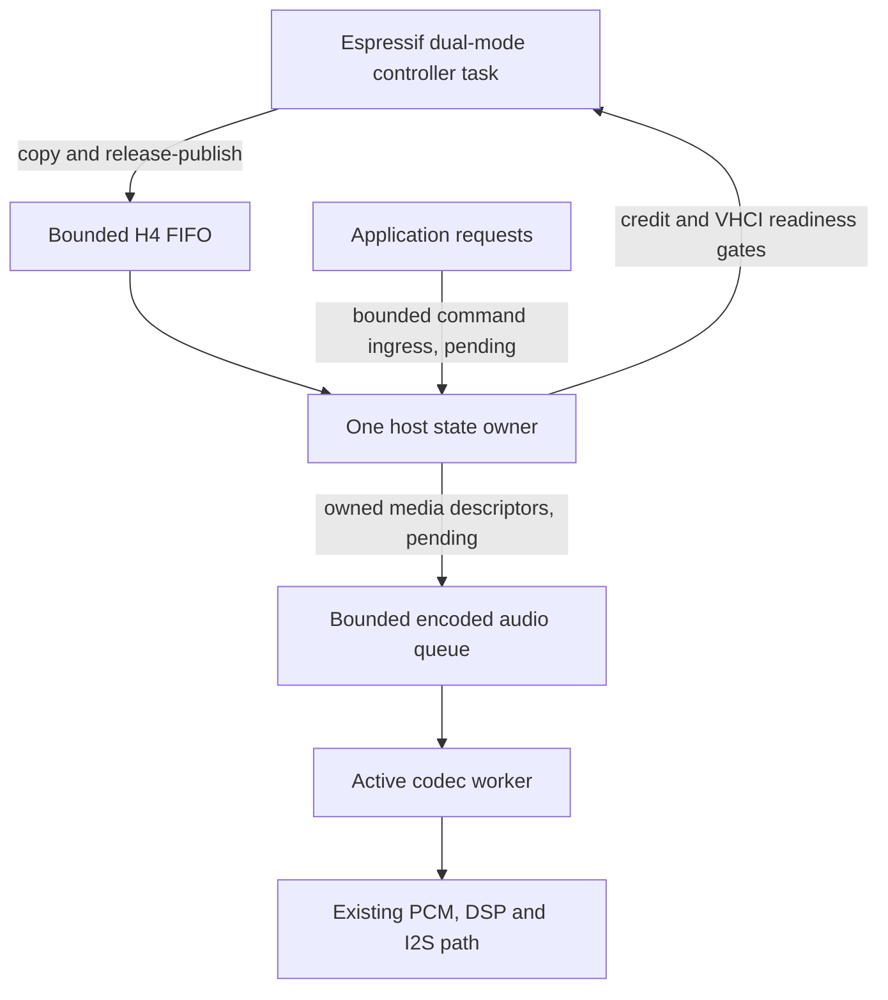

# Architecture and reference review

Reviewed 2026-10-28 against BTstack `51e11ce3692abfe31b4ee3d66cffdeb1ae1626f2`
and this checkout's patched ESP-IDF 5.5.2. All upstream paths below are relative
to `reference/btstack/`; they are reading pointers, not build dependencies.

For checks and source changes after the initial foundation review, use
[current progress](PROGRESS.md), including LHDC V5 and the integer DSP/NVS work.

## Scope and hardware boundary

Replace the Bluetooth **host** above HCI. Retain Espressif's controller for the
baseband, link-layer/link-manager timing, hopping, retransmissions, and radio
arbitration. Classic and LE share one dual-mode controller and HCI transport.
Wi-Fi coexistence adds a separate Espressif radio-arbitration concern; host queue
fairness does not replace it.

The original ESP32 is a Bluetooth 4.2 BR/EDR + LE controller. Implement the host
features it actually reports; a new host cannot add LE 2M, coded PHY, ISO/CIS/BIS
or LE Audio controller support to this chip. Generic LC3 software decoding would
not establish LE Audio interoperability.

Sources: [ESP32 datasheet](https://www.espressif.com/sites/default/files/documentation/esp32_datasheet_en.pdf),
[ESP-IDF 5.5.2 controller/VHCI API](https://docs.espressif.com/projects/esp-idf/en/v5.5.2/esp32/api-reference/bluetooth/controller_vhci.html).

## What BTstack actually does

`platform/freertos/btstack_run_loop_freertos.c` serializes data sources, scheduled
callbacks, queued cross-thread functions, and timers, then sleeps on a task
notification/event until work or the next deadline. Protocol modules advance
state machines in reaction to events and request a future can-send callback when
transport/controller capacity is unavailable. This is cooperative host-state
serialization, not a claim that the radio, controller, audio and every task run
in one loop. Its ESP32 port also bridges controller-task callbacks into the host
loop and has separate audio handling.

`src/btstack_memory.c` already supports fixed-size pools via `MAX_NR_*` and also
heap allocation via `HAVE_MALLOC`. Merely using a loop or pools is not a new
memory optimization over BTstack. Gains need evidence from smaller live state,
fewer copies/wakeups and narrowly sized buffers under equivalent functionality.

The ESP32 reference transport copies callback data into a ring, later delivers
it to the host, and gates sends with VHCI readiness. HCI command credits and ACL
controller credits remain distinct from that transport readiness indication.
`Command Status` success means command admission; it does not mean an
asynchronous operation completed.

The [BTstack configuration manual](https://bluekitchen-gmbh.com/btstack/how_to/)
documents this event/state-machine organization and configurable memory pools.

## Layer inventory and implementation status

| Area | BTstack reading pointers | Requirements for our implementation | Current owned status |
| --- | --- | --- | --- |
| Run loop and platform | `src/btstack_run_loop.c`, `platform/freertos/btstack_run_loop_freertos.c` | Single state owner; bounded work; deadlines; no lost wakeups; cross-task ingress | Integrated HCI/ACL/L2CAP runtime; bounded command/TX work, deadlines and task notification wait. Cross-task application command ingress remains pending |
| Memory and packet ownership | `src/btstack_memory.c`, `src/btstack_memory_pool.c`, ESP32 VHCI port | Explicit capacities and ownership; resource failure visible; no unbounded queues | One 4096-byte SPSC record ring, 520-byte control reserve, FIFO order, overflow latch; host-tested and target-linked |
| HCI transport | `port/esp32/components/btstack/hci_transport_esp32_vhci.c` | Copy callback-lifetime packets; task wakeup; retain TX until transport allows reuse | Owned VHCI/runtime adapter booted on COM6; controller identification/setup succeeded |
| HCI/GAP and controller setup | `src/hci.c`, `src/hci_cmd.c`, `src/gap.h` | Capability/command masks, event masks, names, scan/advertise, link lifecycle, timeouts, command admission | Copied command queue, status/completion, setup, explicit scan/advertising APIs, admission/security hooks; initiator/discovery/privacy pending |
| ACL flow and links | `src/hci.c`, `src/hci.h` | Classic/LE shared or separate credits; Number Of Completed Packets; per-handle tracking; disconnect reclaim; RX host flow control | Integrated link/credit manager and bounded receive-flow module; host buffer setup, no-command-credit acknowledgments and disconnect generation cleanup tested. Long simultaneous RF workload remains failing |
| L2CAP common | `src/l2cap.c`, `src/l2cap.h` | ACL fragmentation/reassembly per handle, fixed channels, dynamic CID allocation, signaling IDs and timers, MTU and errors | Lazy RX, gated TX, generations, channel IDs, bounded signaling inbox/outbox and timers implemented |
| L2CAP Classic | `src/l2cap.c` | Incoming/outgoing setup, bidirectional configuration, disconnect, information requests, security, negotiated ERTM features | Basic channel setup/configuration/disconnect, asymmetric MTUs, options/continuations/duplicates and information responses tested; ERTM pending |
| L2CAP LE | `src/l2cap.c` | ATT/SMP/signaling fixed channels; connection-parameter requests; LE credit-based channels when enabled | Fixed CID registration/routing, ATT bridge and central-side parameter policy callback implemented; SMP and credit channels pending |
| Classic pairing/bonding | `src/hci.c`, `src/classic/btstack_link_key_db_tlv.c` | SSP/PIN events, IO capabilities, link-key lifecycle, encryption/authentication/key-size state and persistence | Owned policy/key lifecycle module and asynchronous NVS probe store; Just Works/encrypted channel observed. Other methods, Linux bond persistence and sustained coexistence need qualification |
| BLE SMP | `src/ble/sm.c`, `src/ble/le_device_db_tlv.c` | Pairing, bonding, encryption keys, privacy, signing, secure connections and authenticated security policy where supported | Pending |
| ATT and GATT server | `src/ble/att_db.c`, `src/ble/att_dispatch.c`, `src/ble/att_server.c` | MTU, attribute permissions/security, errors, reads/writes, prepare/execute, per-link CCCD, notify/indicate confirmation, service changes | Owned LE ATT server/bearer implemented and diagnostic RF read/write/notify run passed; product control/OTA binding, real bonds, robust caching and advanced features pending |
| GATT client | `src/ble/gatt_client.c` | Discovery, procedures, reliable writes, notification subscriptions, timers | Pending; module must be available without allocating unused connection state |
| SDP | `src/classic/sdp_server.c`, `src/classic/sdp_client.c` | Records, data elements, continuation tokens, bounds, service discovery | Owned server and Basic runtime bridge; Linux queries and BlueZ sdptool browse passed. Client and product audio records pending |
| AVDTP and A2DP | `src/classic/avdtp.c`, `src/classic/avdtp_sink.c`, `src/classic/a2dp_sink.c` | Endpoint/CIE negotiation, transactions, signaling fragmentation, stream lifecycle, media framing and codec worker handoff | Owned signaling, sink endpoint/control state, SBC selection validation and asynchronous worker contract host-tested, including paired media channels/RTP. ESP32 archive compiled; actual decoder/media manager integration and playback pending. Preserve SBC/AAC/aptX/aptX-HD/aptX-LL/LDAC/Opus and add LHDC V5 |
| AVCTP and AVRCP | `src/classic/avrcp.c`, controller/target/browsing modules | Transaction labels, pass-through, metadata, volume, notification registration, browsing | Pending |
| RFCOMM and serial | `src/classic/rfcomm.c`, `src/classic/spp_server.c` | Multiplexing, credits, framing, control and channel lifecycle | Pending |
| Voice and other profiles | `src/classic/hfp*.c`, `hsp*.c`, `hid*.c`, `bnep.c`, `pan.c`, `obex*.c`, `goep*.c`, `pbap*.c`, `src/mesh/` | Explicit profile/role matrix, negotiated limits and interoperability; SCO/eSCO routing needs its own controller configuration | Pending. Probe has zero synchronous connections; a shared FIFO SCO frame reservation only satisfies controller buffer setup, not voice/profile coverage |

Supporting all applicable features means an explicit, tested capability matrix.
It does not mean unlimited links or preallocating every possible profile at boot.
Optional protocols remain selectable modules and allocate state only when used.

## Owned execution and packet path

The current FIFO preserves arrival order across event and ACL packets. ACL
admission leaves 520 bytes for two maximum-size HCI event records; reserved
capacity does not reorder packets. Any rejected packet latches a terminal fault,
because continuing after losing a disconnection, command event or ACL fragment
would make protocol state untrustworthy. A production receiver additionally needs
negotiated controller-to-host flow control and per-link reassembly/resource policy.

Only the controller task calls the queue producer API, and only the host owner
calls its consumer API. Acquire/release publication covers the packet bytes and
record header. There is no allocation or protocol callback in ingress. All owner
callbacks must be short and nonblocking; audio decoding and DSP do not belong there.

## Lazy codec memory is a required invariant

Only the active negotiated codec/configuration may own its large mutable context,
frame history, fragment storage, decode scratch and RAM-resident table copies.
Size them from actual channel count, sample rate, frame duration and codec mode.
Do not allocate worst-case storage for every codec or every configuration at boot.
Keep immutable tables as flash-backed `const` data unless measured real-time needs
justify copying only the selected subset into RAM. Cache traffic is not the same
as explicit DRAM allocation and must be measured separately.

The source audit found partial lazy behavior in the current Bluedroid app:

- `btc_a2dp_sink.c` dynamically sizes shared decode scratch per selected codec
  (AAC requires none there), switches decoder interfaces, and cleans up the old one.
- The active AAC build is `aac_decoder_helix.c` plus
  `a2dp_aac_decoder_custom.c`, selected in `esp-idf/components/bt/CMakeLists.txt`.
  The Helix wrapper still has a statically reserved `s_helix_buffer`; the A2DP
  wrapper has a permanent 1024-byte raw AAC buffer, despite allocating other
  decoder/PCM storage lazily.
- The Opus wrapper contains a permanent 6144-byte fragment array even when another
  codec is selected. Its decoder handle is allocated/configured separately.
- LDAC immutable lookup tables are `const`; do not assume they all occupy writable
  RAM. Confirm actual placement with the linked image/map before optimizing them.

These are verified source observations, not current-device memory measurements.
No decoder source was changed during the HCI foundation milestone. The new codec
adapter must correct the static-residency gaps rather than preserve them.

Switch protocol: fence old media input; drain/cancel and join old decode ownership;
release old configuration resources; allocate and validate the exact new plan;
publish the new generation only after initialization succeeds; reject stale queued
frames. Do not overlap two complete decoder working sets by accident. On failure,
remain explicitly stopped/unconfigured, release partial allocations, and report
failure rather than decoding with a half-configured codec.

## Validation and performance criteria

Work order: HCI framing/identification -> controller capability/event setup and
link/credit manager -> L2CAP with wire-vector tests -> pairing/bond persistence ->
GATT + SDP -> AVDTP/A2DP/AVRCP and lazy codec adapters -> concurrent BLE control,
meter and OTA operation -> remaining protocol/profile modules.

For each layer, test malformed/truncated packets, resource exhaustion, timeout,
disconnect/reconnect, cancellation and concurrency before integration. Standard
wire vectors and independently written mocks are the oracle; BTstack behavior is
a review aid, not code to paste or a reason to reproduce an upstream mistake.

Capture equivalent-feature baselines: same ESP32/controller/SDK, link counts,
MTUs, security/bond policy, codec CIE, sample rate/channels/bitrate, audio buffers
and BLE workload. Measure static DRAM/IRAM, live heap and largest block, peak
codec-switch RAM, task stacks, CPU cycles, copies, wakeups, loop delay, media
underruns and latency. Include reconnect/OTA and malformed-traffic behavior so a
smaller but incomplete host cannot pass as an optimization. No speed or memory
superiority over Bluedroid or BTstack is established yet.

Linux tests must record the selected profile separately from the actual BlueZ
MediaTransport codec/configuration, stream packet progress, ESP32 decode/render
progress and physical output. Firefox showing Playing, an advertised endpoint,
a successful profile-selection request, or a completed firmware build alone is
insufficient evidence of codec playback or Classic/BLE coexistence.

## Current lower-layer evidence

- 130 native groups pass on Windows/Linux, including paired runtime channel setup,
  fragmented transfer, disconnect, separate Classic/LE credit stalls and 20,000
  variable-length packets over two concurrent threads. ASan/UBSan passes on Linux.
- ESP32 probe links with controller-only host selection and dual-mode controller
  configuration. Compile-command path audit finds no BTstack, Bluedroid or NimBLE
  host dependency. The linked symbol table contains the owned HCI functions.
- Owned `dbt_host_t`: 6676 bytes on ESP32, 6752 on native x64. The complete owned
  runtime is 10616 bytes on ESP32, including the host, receive-flow state, link/channel metadata and
  fragment TX buffer. This excludes the controller/SDK/task stack, separate GAP
  configuration object, lazy RX fragments, future protocols and codecs.
- The COM6 target probe completed eight identification, two receive-flow and nine GAP configuration
  commands. Original application/bootloader/data layout were preserved; only the
  trial slot and one selector sector were written and verified by readback.
- Independent LE ATT/GATT, Classic pairing/encryption and SDP diagnostics passed.
  A short concurrent data test passed, while the longer untraced run failed.
  Audio/coexistence reliability and comparable full-stack footprint remain unqualified. Latest evidence is in
  [ATT/GATT](ATT_GATT.md), [progress](PROGRESS.md)
  and [release gates](RELEASE_READINESS.md).

Receipts live at fixed paths under `_build/`; do not create timestamped duplicates.
